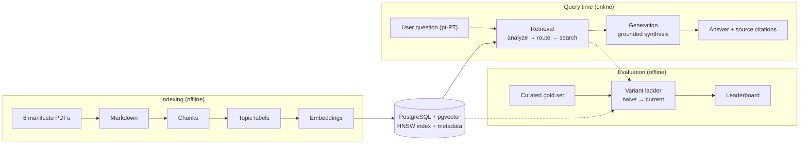

# RAG System for Political Programs Analysis

A unified Retrieval-Augmented Generation (RAG) system for analyzing Portuguese political party programs (2024 elections). The pipeline is structured into three clean stages — **indexing**, **retrieval**, and **generation** — with advanced techniques drawn from the RAG-from-Scratch research series.

## Project Structure

```bash
thesis/
├── main.py                     # CLI entry-point
├── config/
│   └── config.yaml             # Centralized configuration
├── data/
│   ├── 0_raw/                  # Source PDF files
│   ├── 1_markdown/             # Parsed markdown (per party)
│   └── 2_processed/            # Classified JSON outputs
├── src/
│   ├── rag/
│   │   ├── common/             # Shared Pydantic models & constants
│   │   │   ├── models.py
│   │   │   ├── llm_transport.py
│   │   │   └── llm_client.py
│   │   ├── indexing/           # Parse → Chunk → Classify → Embed → Store
│   │   │   ├── parser.py
│   │   │   ├── chunker.py
│   │   │   ├── classifier.py
│   │   │   ├── embedder.py
│   │   │   ├── store.py
│   │   │   └── pipeline.py
│   │   ├── retrieval/          # Analyze → Expand → Route → Search
│   │   │   ├── query_analyzer.py
│   │   │   ├── query_expander.py
│   │   │   ├── router.py
│   │   │   ├── searcher.py
│   │   │   └── pipeline.py
│   │   └── generation/         # LLM clients → Prompts → Synthesis
│   │       ├── pipeline.py
│   │       ├── prompts.py
│   │       ├── synthesizer.py
│   └── utils/
│       └── config_loader.py    # YAML config helper
├── tests/
└── docker-compose.yml          # PostgreSQL 17 + pgvector
```

## Key Techniques

| Technique                     | Source              | Where Used                    |
| ----------------------------- | ------------------- | ----------------------------- |
| Multi-Query Expansion         | Part 5              | `retrieval/query_expander.py` |
| Reciprocal Rank Fusion        | Part 6 (RAG-Fusion) | `retrieval/searcher.py`       |
| Logical Routing               | Part 10             | `retrieval/router.py`         |
| Metadata-Filtered Search      | Part 11             | `indexing/store.py`           |
| Small-to-Big Retrieval        | Part 12 (variant)   | `indexing/chunker.py`         |
| Hybrid Dense + BM25           | —                   | `indexing/bm25.py`            |
| Cross-Encoder Reranking       | —                   | `retrieval/reranker.py`       |

## Core Components

- **PDF Extraction**: `marker_single` CLI tool (produces clean markdown)
- **Chunking**: Header-aware LangChain splitter + recursive windowing, sized in
  *tokens* against the embedding model's own tokenizer (see below)
- **Topic Classification**: Structured LLM output via OpenRouter (18 Portuguese categories, multi-label)
- **Embeddings**: `Qwen/Qwen3-Embedding-0.6B` (1024d, 32k context, retrieval-trained
  and asymmetric — see below for why this replaced `serafim-900m`)
- **Vector Store**: PostgreSQL 17 + pgvector with HNSW index
- **Lexical Index**: generated `tsvector` column (`portuguese` config) + GIN index
- **LLM Generation**: Unified OpenRouter transport with configurable models

### Why the embedding model changed (and why chunks are sized in tokens)

The system originally used `serafim-900m`, which has a **`max_seq_length` of 128
tokens**. Anything past that is dropped at encode time — no error, no warning.
Sizing chunks in *characters* therefore overran the window badly: at
`max_chunk_size: 1600` the median chunk was 365 tokens, **89.5% of chunks were
truncated, and only 37.3% of the corpus was ever embedded**. Probing a chunk with
its own text, it ranked #1 by its opening (cosine 0.986) and was absent from the
top 5 for its own tail — unretrievable by two thirds of its own content.

The root cause was **conflating two different budgets** under one number:

| Budget | Set by | Consequence of exceeding it |
| ------ | ------ | --------------------------- |
| Retrieval | the encoder's `max_seq_length` | silent truncation |
| Generation | the LLM's context window | none, at these sizes |

Chunks were sized sensibly for the LLM, then handed to an encoder that could see
a third of them. Two independent fixes follow from that, and both are kept:

1. **Chunk size is measured in tokens**, using the embedding model's own
   tokenizer, so the budget is expressed in the unit that constrains it.
2. **The encoder was replaced.** The variant used,
   `serafim-900m-portuguese-pt-sentence-encoder-ir`, was already tuned for
   retrieval; its problem was the 128-token window, which it was also trained
   at, so raising the cap would not make it represent long passages well.
   `Qwen3-Embedding-0.6B` has a 32k window, is *smaller* (0.6B vs 0.9B), indexes
   narrower (1024 vs 1536 dims), and scores 78.9 on retrieval in MTEB-PT
   ([arXiv 2607.04071](https://arxiv.org/abs/2607.04071)) — so the encoder is no
   longer what limits chunk size. Chunk size is now a free retrieval-granularity
   choice. MTEB-PT evaluates only the general serafim sentence encoder (54.9 on
   retrieval), not the `-ir` variant, so there is no like-for-like comparison
   yet; the planned encoder comparison on this corpus will provide one.

Note that most modern retrieval encoders, including Qwen3, are **asymmetric**:
queries take an instruction prefix, documents take none. `Embedder` applies
whichever prompts the loaded model declares, so `encode_query` must be used at
search time — `encode` alone silently forfeits the accuracy the prompts exist to
add. Decoder-based encoders also pool the *last* token, and `Embedder` sets left
padding for them to match Qwen3-Embedding's model card. That guard is defensive
rather than load-bearing — sentence-transformers 5.x finds the last *unmasked*
token through the attention mask, so it pools correctly either way — and it is
kept only because the guarantee belongs to the library rather than the model.

`indexing.chunk_strategy` selects how windowing is measured:

| Strategy       | Sizing unit | Truncation on serafim | Generation reads |
| -------------- | ----------- | --------------------- | ---------------- |
| `char`         | characters  | ~89% of chunks        | the chunk    |
| `token`        | tokens      | none                  | the chunk        |
| `small_to_big` | tokens      | none                  | the **parent section** |

`small_to_big` is the default: small children are embedded for precise matching,
while `parent_content` carries the full header section that generation actually
reads. It keeps the two budgets decoupled, so retrieval granularity and
generation context can be tuned independently even on a long-context encoder.
`char` is retained **only** as the evaluation baseline — it is what the
`0% → 100% embedded` ablation is measured against.

Re-index when changing strategy (chunk boundaries move) or the embedding model
(pgvector cannot alter a `VECTOR(n)` column in place, so `--drop` is required):

```bash
python main.py index --all --drop --chunk-strategy small_to_big
```

### Hybrid retrieval

`use_hybrid` adds a Portuguese full-text ranked list per query and fuses it with
the dense lists in a single RRF pass. It exists because dense embeddings
under-weight rare exact tokens — `USF tipo C`, `TMRG`, `RES_U`,
`Cheque-Dentista` — which are exactly the strings a user quotes when asking about
them. Enable it per-variant (`hybrid`, `hybrid_only`) or via `RetrievalConfig`.

### Cross-encoder reranking

`use_reranker` adds a precision pass after fusion. Retrieval embeds the query
and each chunk *independently*, which is what makes searching a whole corpus
affordable and also what caps its accuracy: a chunk's vector cannot depend on
the question. A cross-encoder reads both texts together in one forward pass —
much more accurate, far too slow for a corpus — so it runs second, over a
shortlist.

That shortlist has to be wider than the answer or the pass is pointless:
with the flag on, each sub-query fetches `rerank_candidates` (default 30)
instead of `top_k`, and the reranker trims back to `top_k` at the end.
`rerank_candidates` is therefore the recall ceiling of the reranked variant —
reranking can reorder what retrieval found, never add to it.

Two choices worth knowing:

- The model scores the **original question** against each chunk's **`content`**
  (the embedded child), not its parent section. Under `small_to_big` many
  children share a parent, so scoring the parent would give every sibling the
  same score and destroy the ordering. Generation still reads the parent.
- Reranked results carry `score_type=rerank`: raw relevance logits, unbounded
  and not comparable to cosine or RRF values.

The default model is `BAAI/bge-reranker-v2-m3` (multilingual, trained on pairs
that include Portuguese); `cross-encoder/mmarco-mMiniLMv2-L12-H384-v1` is a much
smaller alternative. Set `retrieval.reranker_model` in `config/config.yaml`.
Enable per-variant (`reranked`, `reranked_only`) or via `RetrievalConfig`.
Expect higher latency — one forward pass per candidate — which the leaderboard's
`avg_latency_s` column is there to price.

## Quick Start

### Prerequisites

```bash
# Start PostgreSQL + pgvector
docker compose up -d

# Create the virtualenv and install pinned dependencies
python3 -m venv .venv
.venv/bin/python -m pip install -r requirements.txt
```

Then either activate it, or call the venv interpreter directly:

```bash
source .venv/bin/activate     # then plain `python main.py ...` works
.venv/bin/python main.py query "..."   # works without activating
```

**Always run the project through `.venv`.** macOS ships its own
`/usr/bin/python3` (currently 3.9.6) with none of these packages, and there are
several `python3` binaries on a typical machine, so a bare `python3 main.py`
depends on how that particular shell resolves the name — it fails at the first
import with `ModuleNotFoundError: No module named 'dotenv'`. The venv removes
that ambiguity; `.python-version` (3.13.5) only records which interpreter to
build it from. To check what you are on:

```bash
which python3 && python3 -V
```

### Environment Variables

Create a `.env` file:

```env
OPENROUTER_API_KEY=your_openrouter_key
```

## Test Flow (All Tests, No Skips)

The project now includes a **dedicated testing DB service** and live LLM smoke tests.

### 1. Start the dedicated test DB

```bash
docker compose up -d postgres_test
```

This service runs on `localhost:5433` and uses database `ragdb_test`.

### 2. Ensure live LLM key is available

Set `OPENROUTER_API_KEY` in your shell or in `.env`.

### 3. Run all tests

```bash
python -m pytest -q
```

By design, DB-backed and live tests now **fail fast** if prerequisites are missing.

### Optional test DB overrides

```bash
export RAG_TEST_DB_HOST=localhost
export RAG_TEST_DB_PORT=5433
export RAG_TEST_DB_NAME=ragdb_test
export RAG_TEST_DB_USER=postgres
export RAG_TEST_DB_PASSWORD=postgres
```

### Run by layer

```bash
python -m pytest -q -m unit
python -m pytest -q -m integration
python -m pytest -q -m e2e
python -m pytest -q -m live
```

### 1. Parse PDFs → Markdown

```bash
python main.py parse --input-dir data/0_raw --output-dir data/1_markdown
```

### 2. Index Documents

```bash
# Index all parties
python main.py index --all

# Index a single party
python main.py index --party livre

# Re-index from scratch (drops existing data)
python main.py index --all --drop

# Classify only (writes checkpoint JSON, no DB required)
python main.py index --party livre-2024-manual --classify-only

# Resume from classified checkpoint without reclassification tokens
python main.py index --from-classified data/2_processed/livre-2024-manual-classified.json --drop
```

### 3. Query

```bash
# Simple question
python main.py query "Quais são as propostas do PS para a educação?"

# Comparison (auto-detected)
python main.py query "Comparar as políticas de saúde do PS e do CHEGA"

# Topic exploration
python main.py query "Que partidos falam sobre imigração?"

# With more context
python main.py query "Políticas ambientais dos partidos de esquerda" --top-k 10
```

## Evaluation

The system is evaluated as a ladder of **implementation steps** (`naive` →
`multiquery` → `routed` → `current` → `hybrid` → `reranked`, plus the
`hybrid_only` / `reranked_only` isolation rungs), all run over the same gold set
so gains are attributable to specific techniques.
Each step is a `RetrievalConfig` preset (feature flags over the *same* production
code) — see `src/rag/evaluation/variants.py`.

```bash
# 1. Anchor the hand-written questions to indexed chunks, review, compile golden.json
python scripts/anchor_gold.py candidates   # then review anchoring/ANCHORING.md
python scripts/anchor_gold.py compile

# 2. Run variants and refresh the leaderboard
python main.py eval --variants naive,current --curated-only
```

Metrics: retrieval (`hit`, `recall`, `mrr`, `ndcg`), routing
(`query_type_acc`, `party_f1`, `topic_f1`), and LLM-judge generation
(`faithfulness`, `answer_relevance`, `correctness`). Results land in
`data/eval/results/` and a committed `data/eval/reports/leaderboard[-<split>].md`.
Full methodology: [`docs/evaluation.md`](docs/evaluation.md).

## Configuration

All settings in `config/config.yaml`:

- **Paths**: data directories
- **Embeddings**: model name, dimension
- **PostgreSQL**: connection details, table name
- **LLM**: OpenRouter model, temperature, max tokens
- **Retrieval**: multi-query count, RRF k-value, default top-k
- **Indexing**: chunk size, overlap, classification model

## Architecture

The system has three parts: **indexing** (offline) builds the vector store;
**retrieval + generation** (online) answer a question with grounded citations;
and an **evaluation harness** (offline) replays the same feature-flagged code as
a ladder of variants. Detailed per-stage diagrams are in
[`docs/architecture.md`](docs/architecture.md).



The **query flow** in words: `User question → Query Analysis (structured LLM) →
Logical Routing by query type` (`single_party` / `comparison` /
`topic_exploration` / `general`, each with metadata-filtered multi-query search
+ RRF) `→ Answer Synthesis (direct / comparison) → final answer
with source citations`.

## Parties Tracked (2024)

| Party                             | Ideology |
| --------------------------------- | -------- |
| Aliança Democrática (AD)          | Right    |
| Bloco de Esquerda (BE)            | Left     |
| CHEGA                             | Right    |
| Iniciativa Liberal (IL)           | Right    |
| LIVRE                             | Left     |
| Pessoas-Animais-Natureza (PAN)    | Left     |
| Partido Comunista Português (PCP) | Left     |
| Partido Socialista (PS)           | Left     |

## API Usage

```python
from src.rag.retrieval.pipeline import retrieve
from src.rag.generation.pipeline import generate

# Full RAG pipeline
result = retrieve("O que propõe o LIVRE sobre habitação?")
answer = generate(result)
print(answer.answer)

# Indexing
from src.rag.indexing.pipeline import index_documents
index_documents(party_filter="livre", drop_existing=True)
```

## Troubleshooting

1. **PostgreSQL not running**: `docker compose up -d`
2. **No API key**: Set `OPENROUTER_API_KEY` in `.env`
3. **No results**: Run `python main.py index --all` first
4. **pgvector not installed**: The Docker image (`pgvector/pgvector:pg17`) includes it

## Contributing

1. Follow the modular structure
2. Add new RAG implementations in `src/rag/`
3. Update configuration schema in `config/config.yaml`
4. Add tests in the `tests/` directory

## License

This project is for academic research purposes.
