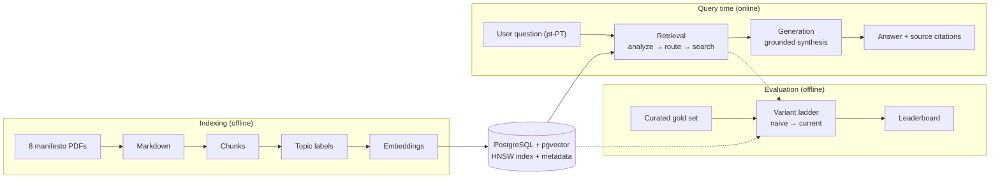
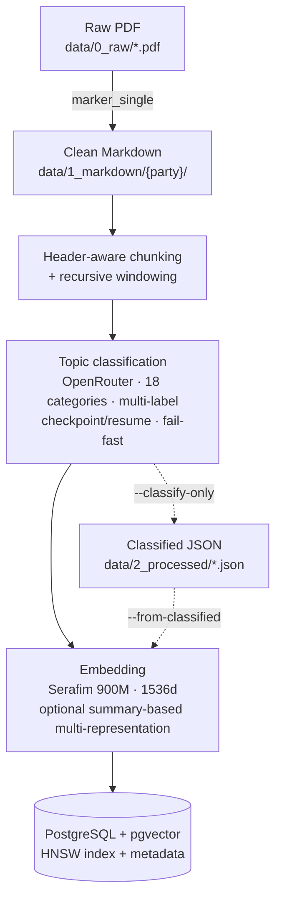
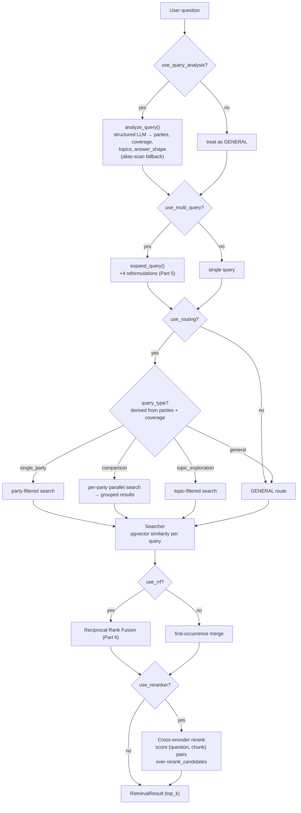
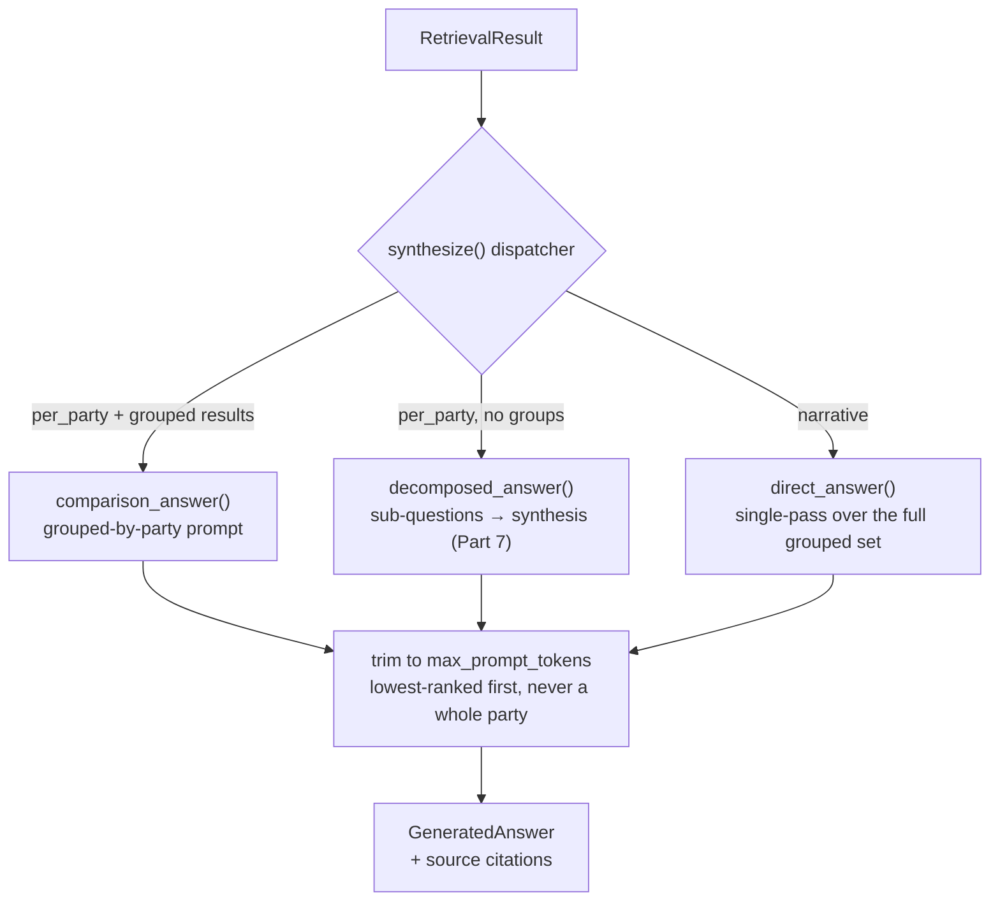
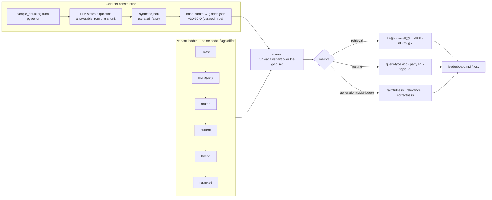

# System Architecture

This document explains how the RAG system works, stage by stage, with Mermaid
diagrams. The system has three parts:

1. **Indexing** (offline) — turns the manifesto PDFs into a searchable vector store.
2. **Retrieval + Generation** (online) — answers a user question with grounded citations.
3. **Evaluation** (offline) — replays the *same* retrieval code as a ladder of
   feature-flagged variants to measure what each technique contributes.

Each retrieval/generation technique maps to a specific method from the
*RAG-from-Scratch* series (noted as "Part N" below).

---

## 1. Overview

The dotted arrows into the evaluation box mean the harness reuses the production
retrieval code and the same vector store — variants differ only by feature
flags, so score differences isolate the contribution of one technique.

---

## 2. Indexing pipeline

`PDF → Markdown → chunk → classify → embed → store`. Orchestrated by
[`indexing/pipeline.py`](../src/rag/indexing/pipeline.py).

- **Parse** — [`parser.py`](../src/rag/indexing/parser.py) wraps the `marker_single` CLI.
- **Chunk** — [`chunker.py`](../src/rag/indexing/chunker.py) splits on markdown headers, then windows recursively.
- **Classify** — [`classifier.py`](../src/rag/indexing/classifier.py) assigns topics via a structured LLM call; results can be checkpointed to JSON so re-indexing spends no classification tokens.
- **Embed** — [`embedder.py`](../src/rag/indexing/embedder.py) uses the Portuguese-specific Serafim encoder.
- **Store** — [`store.py`](../src/rag/indexing/store.py) writes vectors + metadata to pgvector with an HNSW index (Part 11 metadata filtering, Part 12 multi-representation).

---

## 3. Retrieval pipeline

`analyze → expand → route → search`. Entry point:
[`retrieval/pipeline.py`](../src/rag/retrieval/pipeline.py). Every step is gated
by a flag on [`RetrievalConfig`](../src/rag/retrieval/config.py), which is how a
single code path can act as any rung of the variant ladder.

Routing logic lives in [`router.py`](../src/rag/retrieval/router.py); the
similarity search + RRF live in [`searcher.py`](../src/rag/retrieval/searcher.py);
the cross-encoder pass lives in [`reranker.py`](../src/rag/retrieval/reranker.py).

When reranking is on, the search widens before it narrows: each sub-query
retrieves `rerank_candidates` (default 30) rather than `top_k`, and the
cross-encoder re-orders that shortlist before the trim. A reranker can only
promote what retrieval surfaced, so the wide fetch is what gives it room to
work.

---

## 4. Generation (answer synthesis)

The synthesizer picks a strategy from the requested `answer_shape` and the
result shape, then produces an answer with source citations.
[`synthesizer.py`](../src/rag/generation/synthesizer.py).

Shape rather than route, because the two cross: *"que partido propõe mais sobre
habitação?"* needs every party retrieved but answered as one verdict. A
narrative answer over a fan-out reads the whole grouped set rather than
`RetrievalResult.results`, which the router truncates to `top_k`.

Context size is bounded by `llm.openrouter.max_prompt_tokens` rather than by a
result count. Retrieval can now hand generation `top_k_per_party` × 8 parties,
so the prompt is no longer bounded by a small constant; over-budget contexts are
trimmed lowest-ranked first, and a grouped context is trimmed from whichever
party contributes most so that no party is dropped outright. Citations follow
the trimmed context — a source the model never read is one it cannot have used.

---

## 5. Evaluation harness

The harness measures each **implementation step** on the same gold set. Because
every variant runs the production retrieval code with only different flags, a
score delta is attributable to one technique. Code:
[`src/rag/evaluation/`](../src/rag/evaluation/); methodology:
[`evaluation.md`](evaluation.md).

Retrieval ground truth is matched by **content hash**, not database UUID, so the
gold set survives re-indexing as long as chunking parameters are unchanged (see
[`keys.py`](../src/rag/evaluation/keys.py)).
