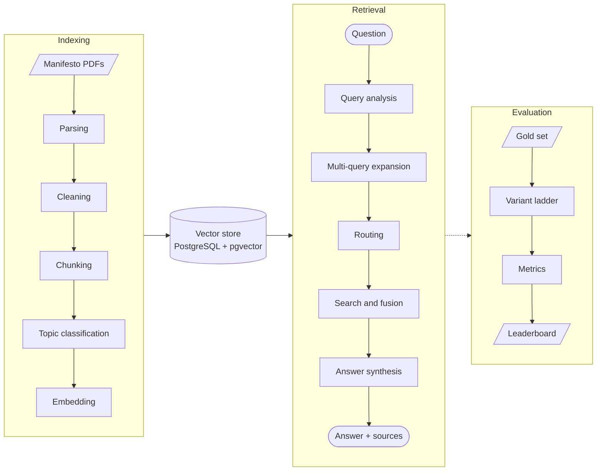
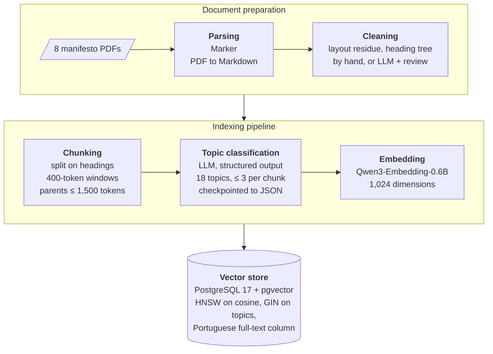
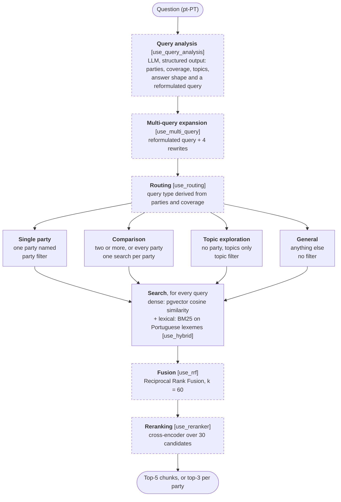
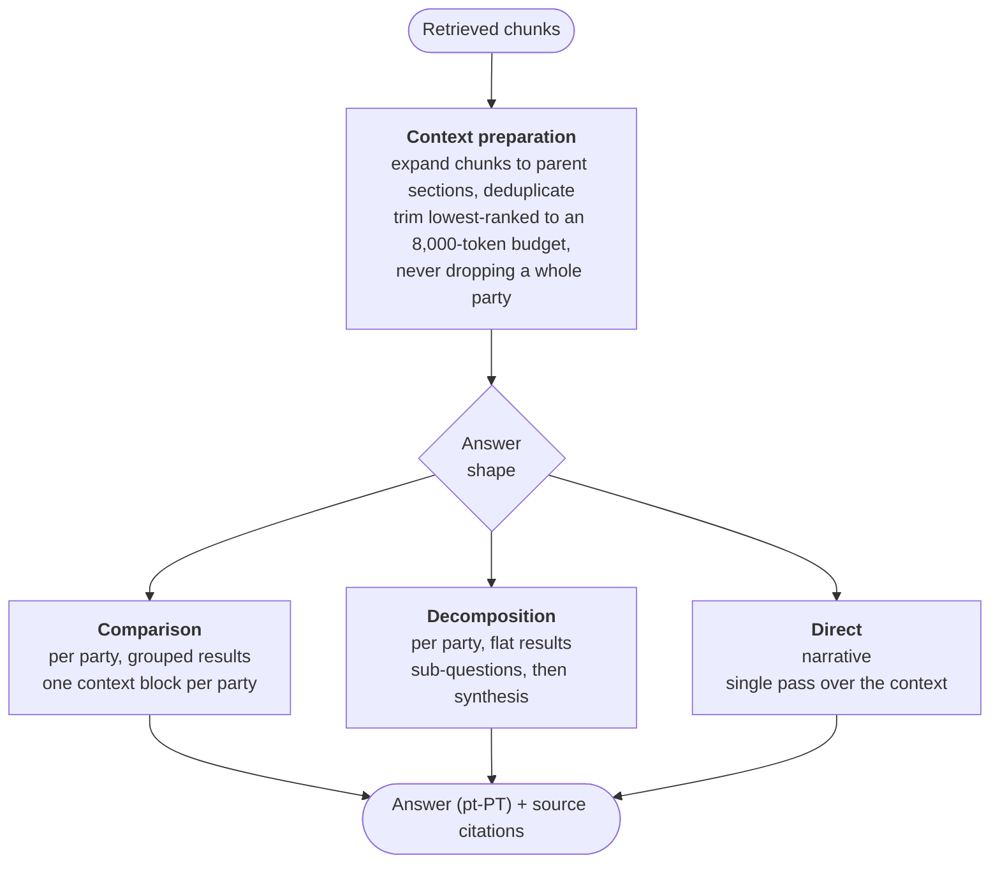
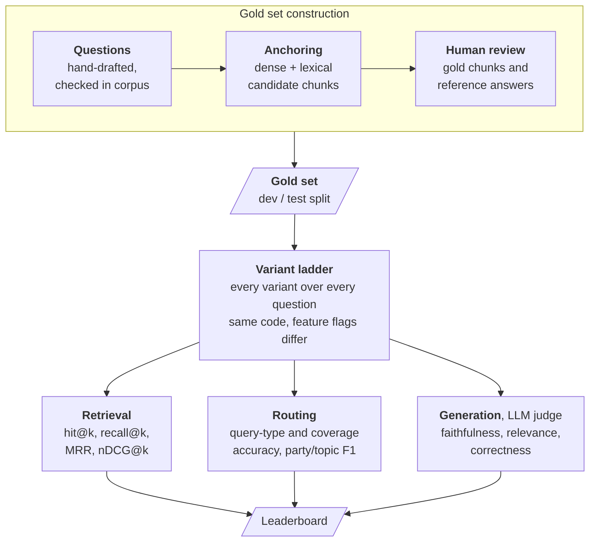

# System Architecture

This document explains how the RAG system works, stage by stage, with Mermaid
diagrams. The system has three parts:

1. **Indexing** (offline) — turns the manifesto PDFs into a searchable vector store.
2. **Query time** (online) — answers a user question with grounded citations.
3. **Evaluation** (offline) — replays the *same* retrieval code as a ladder of
  feature-flagged variants to measure what each technique contributes.

Each retrieval/generation technique maps to a specific method from the
*RAG-from-Scratch* series (noted as "Part N" below).

The diagrams are also the dissertation's figures:
`[scripts/render_diagrams.sh](../scripts/render_diagrams.sh)` renders every
block below, in order, to `dissertation/images/architecture-*.pdf`. Keep the
labels conceptual (code links go in the prose) and re-run the script after
editing a diagram.

---

## 1. Overview

The dotted arrow into evaluation means the harness reuses the production
retrieval code and the same vector store — variants differ only by feature
flags, so score differences isolate the contribution of one technique.

---

## 2. Indexing pipeline

`PDF → Markdown → clean → chunk → classify → embed → store`. Parsing and
cleaning are separate commands (`main.py parse`, `main.py clean`); the rest is
orchestrated by `[indexing/pipeline.py](../src/rag/indexing/pipeline.py)`.

- **Parse** — `[parser.py](../src/rag/indexing/parser.py)` wraps the `marker_single` CLI; raw output goes to `data/1_markdown/_raw/`.
- **Clean** — `[cleaner.py](../src/rag/indexing/cleaner.py)` runs a deterministic residue pass, then an LLM pass that may only keep, demote or drop heading candidates (any output word absent from the input is rejected). AD, LIVRE, PCP and PS were corrected by hand instead.
- **Chunk** — `[chunker.py](../src/rag/indexing/chunker.py)` splits on headings, then windows recursively in tokens of the embedding model's own tokenizer (`small_to_big`). The window is embedded; its parent section (capped at `indexing.max_parent_tokens`) is what generation reads.
- **Classify** — `[classifier.py](../src/rag/indexing/classifier.py)` assigns topics via a structured LLM call, fail-fast. Results are checkpointed to `data/2_processed/*-classified.json` (`--classify-only`), so re-indexing from them (`--from-classified`) spends no classification tokens.
- **Embed** — `[embedder.py](../src/rag/indexing/embedder.py)` uses `Qwen/Qwen3-Embedding-0.6B` (32k-token window); queries get the model's instruction prefix, documents do not. Optional summary-based multi-representation (Part 12) exists but is off.
- **Store** — `[store.py](../src/rag/indexing/store.py)` writes vectors + metadata to pgvector: HNSW for similarity, GIN on the topic array for filters (Part 11), and a generated Portuguese `tsvector` whose lexemes [`bm25.py`](../src/rag/indexing/bm25.py) ranks for lexical search.

---

## 3. Retrieval pipeline

`analyze → expand → route → search → fuse → rerank`. Entry point:
`[retrieval/pipeline.py](../src/rag/retrieval/pipeline.py)`. Dashed stages are
gated by a flag on `[RetrievalConfig](../src/rag/retrieval/config.py)` (named
in brackets), which is how a single code path can act as any rung of the
variant ladder.

Routing logic lives in `[router.py](../src/rag/retrieval/router.py)`; the
similarity search, lexical search and RRF live in
`[searcher.py](../src/rag/retrieval/searcher.py)`; the cross-encoder pass lives
in `[reranker.py](../src/rag/retrieval/reranker.py)`.

With a flag off, each stage degrades instead of disappearing:

| Flag off             | Behaviour                                                       |
| -------------------- | --------------------------------------------------------------- |
| `use_query_analysis` | no LLM call; question treated as GENERAL (no parties or topics) |
| `use_multi_query`    | one query: the reformulated question                            |
| `use_routing`        | every query takes the GENERAL route                             |
| `use_hybrid`         | dense lists only (`dense_only` and the first three rungs)       |
| `use_rrf`            | lists merged by first occurrence                                |
| `use_reranker`       | fused list trimmed straight to `top_k` (the default)            |

Details the diagram compresses:

- **Query analysis fallback.** If the LLM call fails, an exact party-alias scan
sets the parties and coverage falls to *exhaustive*, so the router fans out
rather than silently omitting parties.
- **Topic filters are a preference.** Single-party and comparison searches also
apply the analysed topics. Any topic-filtered search that matches nothing is
retried without the filter (per party, for comparisons).
- **Comparison** searches every named party, or all eight when the question
asks for exhaustive coverage without naming any.
- **Hybrid** adds a lexical list per query, so `2 × len(queries)` lists are
fused in one RRF pass.
- **Reranking** widens before it narrows: each sub-query retrieves
`rerank_candidates` (default 30) rather than `top_k`, and the cross-encoder
scores the *original* question against each chunk before the trim. A
reranker can only promote what retrieval surfaced, so the wide fetch is what
gives it room to work.

---

## 4. Generation (answer synthesis)

The synthesizer prepares the context, then picks a strategy from the requested
`answer_shape` and the result shape, and answers with source citations.
`[synthesizer.py](../src/rag/generation/synthesizer.py)`.

Shape rather than route, because the two cross: *"que partido propõe mais sobre
habitação?"* needs every party retrieved but answered as one verdict. A
narrative answer over a fan-out reads the whole grouped set rather than
`RetrievalResult.results`, which the router truncates to `top_k`. Decomposition
(Part 7) is kept for the one case it addresses: a per-party question whose
results arrived flat.

Context size is bounded by `llm.openrouter.max_prompt_tokens` rather than by a
result count. Retrieval can hand generation `top_k_per_party` × 8 parties, so
over-budget contexts are trimmed lowest-ranked first, and a grouped context is
trimmed from whichever party contributes most so that no party is dropped
outright. Citations follow the trimmed context — a source the model never read
is one it cannot have used. An empty retrieval returns a fixed "no documents
found" reply without calling the LLM.

---

## 5. Evaluation harness

The harness measures each **implementation step** on the same gold set. Because
every variant runs the production retrieval code with only different flags, a
score delta is attributable to one technique. Code:
`[src/rag/evaluation/](../src/rag/evaluation/)`; methodology:
`[evaluation.md](evaluation.md)`.

Gold questions are anchored by
`[scripts/anchor_gold.py](../scripts/anchor_gold.py)`: it retrieves candidate
chunks into `anchoring/ANCHORING.md`, a human ticks the gold chunks and writes
the reference answer, and `compile` writes `golden.json`. Tune on `dev`, report
headline numbers on `test` (`main.py eval --split test --curated-only`). A
synthetic path (`main.py eval-dataset`, LLM questions anchored to sampled
chunks) also exists, for smoke tests.

Retrieval ground truth is matched by **content hash**, not database UUID, so the
gold set survives re-indexing as long as chunking parameters are unchanged (see
`[keys.py](../src/rag/evaluation/keys.py)`).